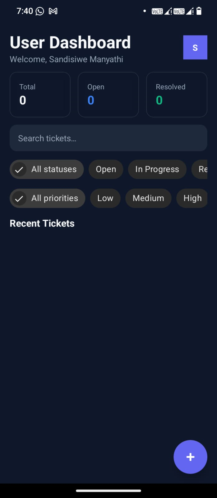
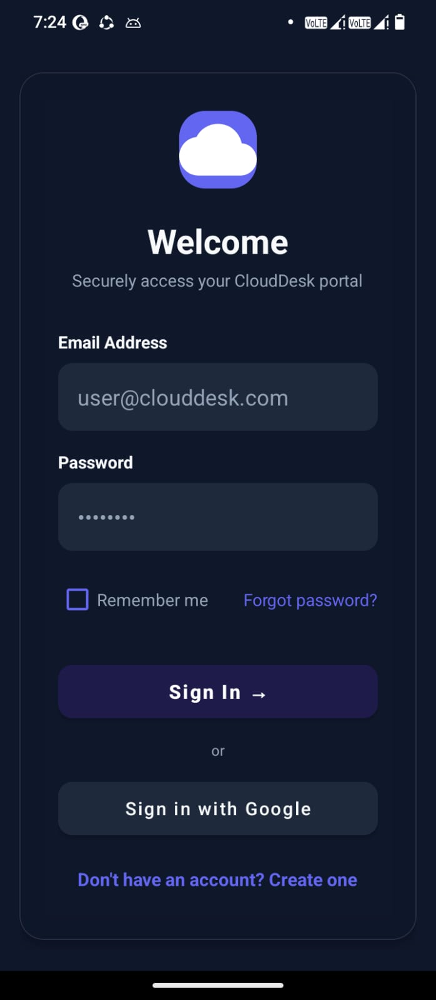
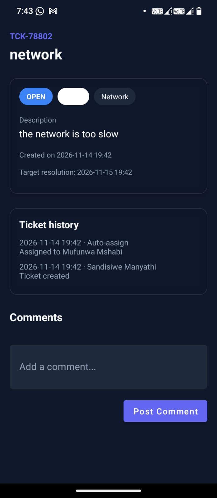
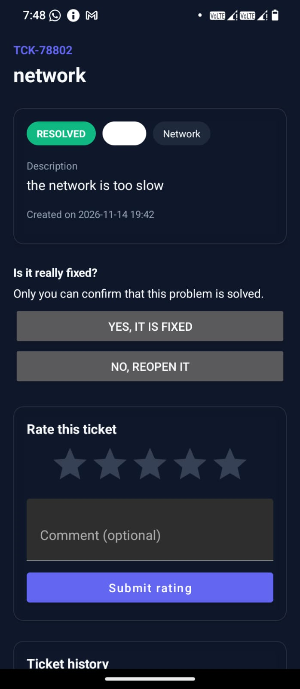
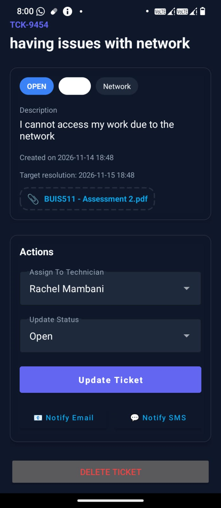
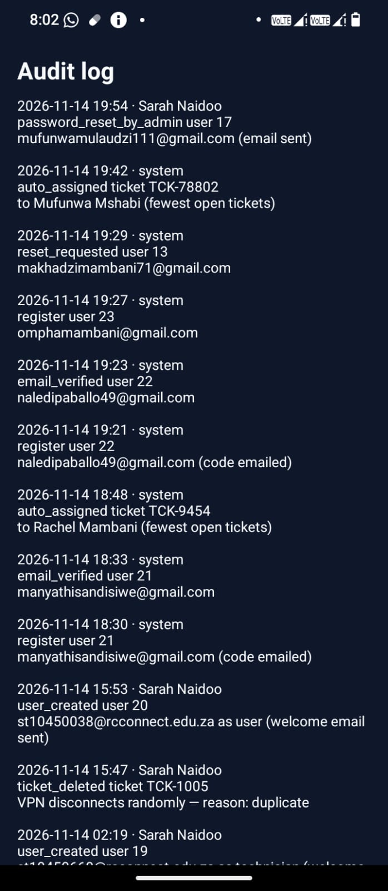
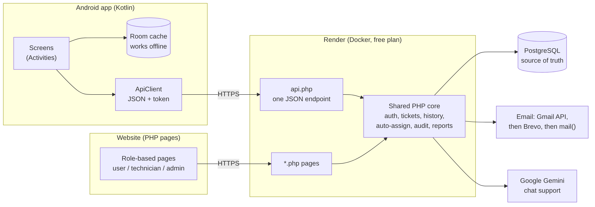
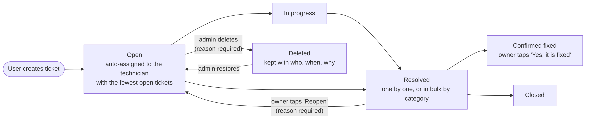
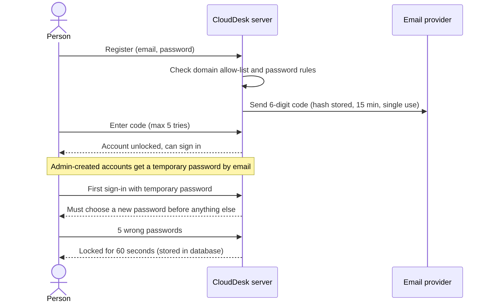
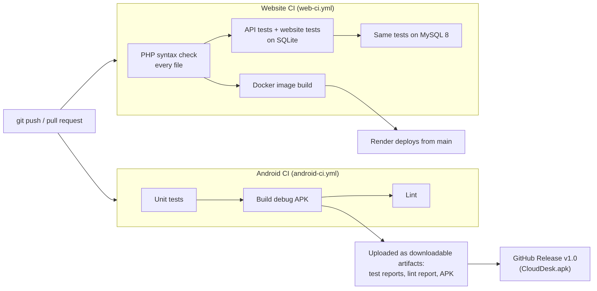

# ☁️ CloudDesk – Android app

### Report IT problems from your phone and watch them get fixed

**[📱 Download CloudDesk.apk](https://github.com/RayMambani/CloudDesk-Mobile-Application2/releases/latest)** ·
**[📝 Release notes](RELEASE_NOTES.md)** ·
**[🌐 Live website](https://clouddesk-web-application.onrender.com)** ·
**[📂 Website and API source](https://github.com/RayMambani/CloudDesk-Web-Application)**

> **WIL XISD6329 – Task 2.** This repository holds the CloudDesk **Android app** (Kotlin). The website, API and database
> are in the [web repository](https://github.com/RayMambani/CloudDesk-Web-Application), described in its README. This
> report covers both.
> Student: **[your name and student number]** · GitHub: [@RayMambani](https://github.com/RayMambani)

---

## Contents

1. [Purpose of the app](#1-purpose-of-the-app)
2. [Screenshots](#2-screenshots)
3. [How it works](#3-how-it-works)
4. [Design considerations](#4-design-considerations)
5. [Innovative features](#5-innovative-features)
6. [How GitHub is used](#6-how-github-is-used)
7. [How GitHub Actions is used](#7-how-github-actions-is-used)
8. [Testing](#8-testing)
9. [Build and install](#9-build-and-install)
10. [Release notes](#10-release-notes)
11. [Limitations and future work](#11-limitations-and-future-work)

---

## 1. Purpose of the app

### The problem
When something breaks at work (a laptop will not start, the Wi-Fi drops, a password is locked), requests are made by
phone, chat or in person. They get lost, nobody knows who is dealing with what, and managers cannot tell whether the
IT team is coping.

### The solution
**CloudDesk** turns every problem into a **ticket** that is tracked from the moment it is reported until the person
confirms it is fixed. The Android app lets people report and follow problems from wherever they are; it shares one
online database with the CloudDesk website, so a ticket created on the phone appears on the computer straight away.

### Who uses it
| Role | What they do in the app |
|---|---|
| **User** | Creates tickets (with a photo or file), follows status, comments, chats with support, confirms the fix or reopens the ticket, rates the service |
| **Technician** | Sees all tickets sorted by AI-assessed urgency, works on assigned tickets, watches SLA due dates, resolves tickets together by category |
| **Administrator** | Manages users, runs auto-assignment, reads performance reports, deletes and restores tickets, reads the audit log |

### Goals
1. Every IT request in one place, on the phone you already carry.
2. Work shared **fairly** between technicians.
3. A ticket only counts as solved when the **user agrees**.
4. Secure accounts and a trail of every sensitive action.
5. Available in English, Sepedi, Tshivenda and Xitsonga.

---

## 2. Screenshots

| Sign in | Dashboard | Ticket detail |
|---|---|---|
|  |  |  |

| Confirm or reopen | Admin menu | Audit log |
|---|---|---|
|  |  |  |

### 👉 [See every screen of the app](docs/APP_SCREENS.md)

All 31 screens with a short explanation of each: sign-up and verification, password reset, forced password change, the user,
technician and admin dashboards, ticket detail, confirm and reopen, rating, chat, analytics, settings, user management,
performance report, deleted tickets, audit log, and the languages and themes. The website screens, including the graphs, are in the
[web repository](https://github.com/RayMambani/CloudDesk-Web-Application/blob/main/docs/SCREENS.md).

---|---|---|
|  |  |  |

| Confirm or reopen | Admin menu | Audit log |
|---|---|---|
|  |  |  |

---

## 3. How it works

- The app never stores passwords. It signs in through the JSON API and keeps a **login token**; passwords are checked
  and hashed (bcrypt) on the server.
- After every action the server returns everything the person may see, and `ServerSync` replaces the local **Room**
  cache with it. Every screen reads from Room, so tickets can still be read without a connection, and the app shows an
  **offline banner**.
- The online PostgreSQL database is the **source of truth**; losing the phone loses no data.

### The life of a ticket

### Signing up and signing in

### Code map
| Area | Files |
|---|---|
| Network and sync | `ApiClient`, `ApiConfig`, `ServerSync`, `ConnectivityHelper` |
| Accounts | `LoginActivity`, `RegisterActivity`, `EmailCodeDialog`, `ForgotPasswordActivity`, `ChangePasswordActivity`, `BiometricHelper`, `SessionManager` |
| Tickets | `MainActivity`, `TicketAdapter`, `SubmitTicketActivity`, `TicketDetailActivity`, `TicketHistoryLogger`, `TicketVocabulary`, `SlaHelper`, `TicketPriorityAI` |
| Admin | `UserManagementActivity`, `PerformanceReportActivity`, `AdminLogActivity` |
| Support | `ChatActivity`, `GeminiClient`, `FaqActivity`, `AnalyticsActivity` |
| Local data | `AppDatabase`, `*Entity`, `*Dao` (Room) |
| Look and language | `ThemeHelper`, `LocaleHelper`, `res/values-*` |

---

## 4. Design considerations

### 4.1 People first
- **Role-based screens**: users never see admin controls.
- **Icons have words**: `BaseActivity` gives every icon button a long-press tooltip and a content description for TalkBack.
- **Four languages and light/dark themes**, chosen in Settings.
- **Plain messages** that say what happened and what to do next.
- **Offline-friendly**: cached tickets and an offline banner.
- **Fingerprint / screen-lock sign-in** for the account that turns it on.

### 4.2 Security by design
| Risk | How it is handled |
|---|---|
| Fake emails | Account stays locked until the emailed 6-digit code is entered (15 minutes, single use, 5 tries) |
| Weak passwords | 8+ characters with upper, lower and a digit; common passwords such as `1234` are refused (checked by the server) |
| Password guessing | 5 wrong passwords lock the account for a minute; the counter is stored on the server |
| People giving themselves power | The role field was **removed** from the sign-up screen; self-registration always creates a normal user and only an admin can change roles |
| Admin knowing passwords | Accounts created by an admin get a temporary password by email; the app forces a new password at first sign-in (`ChangePasswordActivity`) |
| Stolen or revoked logins | Tokens are revoked when a password is reset or an account is deactivated; the app then returns to the login screen |
| Secrets | The Gemini key lives in a git-ignored file. CI builds with a placeholder. **Do not publish an APK built with a real key unrestricted.** |

### 4.3 Key technical decisions
| Decision | Reason |
|---|---|
| Server is the single source of truth; Room is a cache | One version of every ticket, and the same rules for app and website |
| Priority scoring runs **on the phone** (`TicketPriorityAI`) | Instant, no network needed, easy to unit-test |
| Status, priority and category are stored as fixed English keys and translated only for display | Business logic never breaks when the language changes (`TicketVocabulary`) |
| Fairness rule on the server | Assignment is identical whether the ticket came from the app or the website |

---

## 5. Innovative features

1. **Fair automatic assignment** – each new ticket goes to the technician with the fewest open tickets; admins can spread a backlog from the app menu (**Auto-assign unassigned**).
2. **"Is it really fixed?"** – the owner confirms the fix or reopens with a reason; the performance report shows confirmed counts and a **reopen rate**.
3. **Resolve by category** – category chips plus **Update all shown tickets** close a whole group with one message to every owner.
4. **Recoverable deletes and an audit log** – admin screens for **Deleted tickets** (with Restore) and the **Audit log**.
5. **Email-verified accounts, one-time codes, throttling, forced password change.**
6. **AI-assisted triage** (on-device priority score) and **Gemini chat support**.
7. **Fingerprint sign-in, Google sign-in**, and **four South African languages**.

---

## 6. How GitHub is used

| Practice | How it is used |
|---|---|
| **Two repositories** | This app repo, and the [web repo](https://github.com/RayMambani/CloudDesk-Web-Application) for the website, API and database |
| **Clear commits** | Each commit has a title and a bulleted description of what changed and why |
| **Secrets kept out** | `GeminiConfig.kt` is git-ignored; CI creates a placeholder |
| **Automated checks** | GitHub Actions builds, tests and lints on every push and pull request |
| **Releases** | The app is published as a **GitHub Release** (`v1.0`) with a downloadable `CloudDesk.apk` and release notes |
| **Documentation** | This README is the report; [RELEASE_NOTES.md](RELEASE_NOTES.md) lists what changed |

---

## 7. How GitHub Actions is used

`.github/workflows/android-ci.yml` runs on every push to `main` and every pull request:

| Step | What it does |
|---|---|
| Set up Java 17 and Gradle | Same toolchain every time |
| Create placeholder `GeminiConfig.kt` | The real key is not in GitHub, so CI makes a harmless one and the app still builds |
| `testDebugUnitTest` | Runs the unit tests |
| `assembleDebug` | Builds the debug APK |
| `lintDebug` | Static analysis for common mistakes |
| Upload artifacts | The test report, lint report and the **APK** are attached to the run |

Open the **Actions** tab, pick a run and a step to see exactly what passed or failed. The badge at the top shows the
latest result. The website has its own workflow (PHP syntax check, about 320 API and website checks on SQLite and MySQL,
and a Docker build), described in the [web README](https://github.com/RayMambani/CloudDesk-Web-Application#7-how-github-actions-is-used).

---

## 8. Testing

**57 unit tests** run in Actions:

| Test class | Covers |
|---|---|
| `ApiClientTest` | Parsing server answers and mapping error codes to messages |
| `DatabaseTest` | Room: tickets, users, comments, history |
| `PasswordHasherTest` | Password hashing |
| `SecurityQuestionsTest` | Security-question handling |
| `SessionManagerTest` | Signed-in state |
| `SlaHelperTest` | Due dates and overdue calculation |
| `TicketPriorityAITest` | AI priority scoring |
| `TicketVocabularyTest` | Status / priority / category keys and translation |

The server rules the app depends on (sign-in, verification, throttling, roles, bulk update, confirm/reopen,
auto-assignment, delete/restore, audit lists) are covered by about 150 API tests in the web repository, which run on
every push there.

---

## 9. Build and install

**Install:** open [Releases](https://github.com/RayMambani/CloudDesk-Mobile-Application2/releases/latest) on your phone,
download `CloudDesk.apk`, open it and allow *Install from this source* if asked.

**Build it yourself**
1. Open the project in Android Studio (compile SDK 34, minimum Android 7.0 / API 24).
2. Create `GeminiConfig.kt` next to `GeminiClient.kt` (it is git-ignored) with `object GeminiConfig { const val API_KEY = "PASTE_YOUR_GEMINI_API_KEY_HERE"; const val MODEL = "gemini-3.6-flash" }`. Keep the placeholder, or add your own key; with the placeholder, chat uses its built-in replies.
3. Check `BASE_URL` in `ApiConfig.kt` is `https://clouddesk-web-application.onrender.com/` (the app adds `api.php`).
4. **Build → Build APK(s)**.

Demo accounts (password `password123`): `admin@clouddesk.com`, `john.tech@clouddesk.com`, `grace@company.com`.

---

## 10. Release notes

Full list: **[RELEASE_NOTES.md](RELEASE_NOTES.md)**. Version **1.0** adds, since the prototype: the shared online database
and API, email verification and password reset by code, fair auto-assignment, owner confirmation with reopen rate, bulk
resolve by category, soft delete with restore, the audit log, forced password change for admin-created accounts,
tooltips on every icon, and GitHub Actions with a downloadable APK.

---

## 11. Limitations and future work

- Sepedi, Tshivenda and Xitsonga text for the newest screens still shows English.
- Gemini chat calls Google directly with a key inside the APK; routing it through the server would be safer.
- Push notifications, and an end-to-end UI test of the app.
- The APK is a debug build, not published on Google Play.
- The free web hosting sleeps when idle, so the first request after a pause is slow.
